<div align="center">

# AppUpdater

**Zero-infrastructure Intune Win32 packaging for Windows IT admins**

Builds deployment-ready packages from `.exe`, `.msi`, `.msix` and portable `.zip` installers, remembers each app so the next version packages in seconds, checks every installer before it ships, writes Endpoint Privilege Management rules into Intune and keeps them current as vendors release new versions — and optionally connects to a Cloudflare Worker it deploys itself, giving you a live web dashboard, per-device telemetry, and TOTP-protected authentication.

<br/>


[](https://github.com/Lyvvy-xyz/Appupdater/actions/workflows/click-test.yml)
[](LICENSE)

<br/>

**[Download AppUpdater.ps1](https://github.com/Lyvvy-xyz/Appupdater/releases/latest/download/AppUpdater.ps1)** — one file; it fetches every dependency on first run.

<br/>

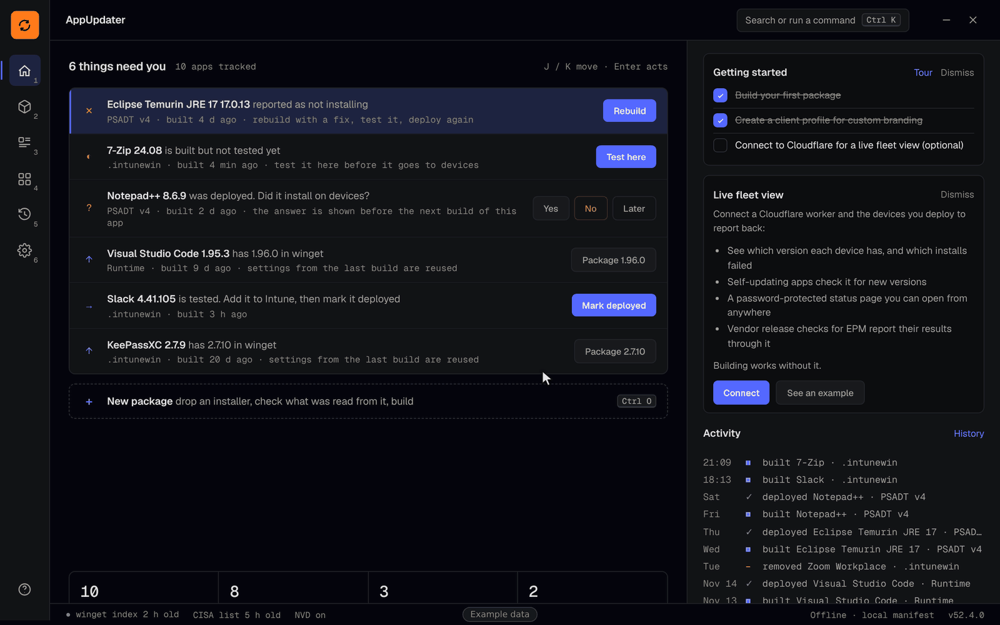

<sub>Pick an installer, build, test it as Intune would: about a minute.</sub>

<br/>

[Overview](#overview) · [See it in action](#see-it-in-action) · [Why AppUpdater](#why-appupdater) · [How it works](#how-it-works) · [Quick Start](#quick-start) · [The Interface](#the-interface) · [Building a Package](#building-a-package) · [EPM rules](#endpoint-privilege-management-epm) · [Cloudflare Mode](#cloudflare-mode) · [Security](#security) · [Reference](#reference)

</div>

---

## Overview

AppUpdater runs on an IT admin's Windows machine and turns any installer into a complete Intune Win32 deployment in minutes. It auto-downloads every tool it needs — including `IntuneWinAppUtil.exe` and `PSAppDeployToolkit` — so there is nothing to install beforehand.

Each app build gives you a **`.intunewin` package** for upload to the Intune portal plus its scripts. Which scripts depends on how the app stays up to date:

- **Updates itself** (Runtime) — a **deploy script** that sets up a self-updating agent on the device (a scheduled task, log files with locked-down permissions, and a desktop shortcut any user can click without admin rights) and a **detection script** that checks for that task and its script
- **You push updates** (Simple) — **install**, **uninstall** and **detect** scripts; detection reads the app's Add/Remove Programs entry and, if you set one, its minimum version

An **EPM rule** build makes no package at all, just the rule values (see [EPM](#endpoint-privilege-management-epm)).

> [!TIP]
> **Everything is self-contained.** AppUpdater downloads `IntuneWinAppUtil.exe` from Microsoft's official GitHub repository on first build, verifies the Authenticode signature, and reuses it from then on. PSAppDeployToolkit is cached the same way. You only need PowerShell 5.1 and admin rights.

The file you download is `AppUpdater.ps1`; in this repository it is `host.ps1`. They are the same script.

### Feature Highlights

<table>
<tr>
<td><strong>Dark-theme WebView2 GUI</strong> with guided tour &amp; accessibility modes</td>
<td><strong>Optional Cloudflare Worker</strong> backend — auto-deployed</td>
</tr>
<tr>
<td><strong>Auto-generates</strong> <code>.intunewin</code> + detect + deploy scripts</td>
<td><strong>TOTP MFA</strong> for the web dashboard</td>
</tr>
<tr>
<td><strong>Auto-downloads</strong> IntuneWinAppUtil &amp; PSAppDeployToolkit</td>
<td><strong>Windows Credential Manager</strong> (DPAPI) token storage</td>
</tr>
<tr>
<td><strong>Authenticode verification</strong> of all downloaded binaries</td>
<td><strong>Per-app event telemetry</strong> with HMAC secrets</td>
</tr>
<tr>
<td><strong>Full offline mode</strong> — no cloud required</td>
<td><strong>Guided tour</strong> on first launch</td>
</tr>
<tr>
<td><strong>PSADT v3 &amp; v4 export</strong> for close-apps prompts</td>
<td><strong>HMAC-signed sessions</strong>, rate-limited login</td>
</tr>
<tr>
<td><strong>EXE, MSI, MSIX and portable ZIP</strong> installers, with switches from the winget catalogue</td>
<td><strong>Remembers each app</strong>: a newer installer brings back the last build's settings</td>
</tr>
<tr>
<td><strong>Pre-deploy checks</strong>: signature, winget hash, CISA and optional NIST NVD</td>
<td><strong>Local test</strong> that installs, detects and uninstalls as Intune would</td>
</tr>
<tr>
<td><strong>Version-aware detection</strong>, so older copies are upgraded</td>
<td><strong>winget-pkgs contributions</strong> from a tested package</td>
</tr>
<tr>
<td><strong>EPM rules</strong> built from an installer, without making a package</td>
<td><strong>Add to Intune</strong>: one EPM policy per app, written and read back</td>
</tr>
<tr>
<td><strong>Vendor release checks</strong> on a hosted machine: new version, signer, SHA-256, winget</td>
<td><strong>Azure option</strong> that adds each verified version to Intune by itself, costs shown first</td>
</tr>
<tr>
<td><strong>In-app walkthroughs</strong> for Cloudflare, Intune and Azure; no separate windows</td>
<td><strong>Runs history</strong>: what each check found, skipped or blocked, and why</td>
</tr>
</table>

### Operating Modes

| | Cloudflare-Connected | Offline |
|---|---|---|
| **Manifest hosting** | Cloudflare KV (`APP_MANIFEST` namespace) | Local `appVersions.xml` |
| **Authentication** | TOTP + PBKDF2-SHA256 session | N/A |
| **Device telemetry** | Per-device event log via Worker | None |
| **Web dashboard** | `https://{worker}.workers.dev/status` | None |
| **Token storage** | Windows Credential Manager (machine scope) | N/A |
| **Setup** | Cloudflare API token, then a 4-step walkthrough inside the app | None |
| **Launch** | `.\AppUpdater.ps1`, then **Worker & settings → Connect** | `.\AppUpdater.ps1` (the default until you connect) |

---

## See it in action

Every part of the app has a short recording in its own section. Jump to one:

| Recording | Shows |
|---|---|
| [Getting around](#the-interface) | Home and its deployment check-in, App fleet filters and bulk actions, History, Client profiles, Settings, Docs |
| [Ctrl K and display options](#the-interface) | The command search, high contrast and the colour-blind safe palette |
| [Building a package](#building-a-package) | The three questions, an installer read for you, the manifest and checks, the finished package with every Intune value |
| [Testing it here](#local-test-and-follow-ups) | Install, detect and uninstall as SYSTEM, then the suggested minimum version and a winget fix |
| [A check stops a build](#pre-deploy-checks) | The next version recognised, a changed signer, and **Build anyway** |
| [PSADT and branding](#phase-4--what-you-get) | Client profiles and the live PSADT v3 / v4 preview |
| [Printers](#printer-packages) | Built-in driver families, one driver for a model family, queue and port |
| [EPM rule](#building-a-rule) | The spotlight walkthrough, then a rule with no package |
| [EPM into Intune](#add-to-intune) | Switching on writes, device-code sign-in, your policies, add and read back |
| [Keeping EPM current](#vendor-release-checks) | The setup map, choosing GitHub or Azure with costs, the Azure walkthrough, Runs |
| [Connecting Cloudflare](#connecting) | The four-step connect with a live setup log |
| [Worker actions](#worker-actions) | Your own domain, token rotation, disconnect |

> [!NOTE]
> The recordings drive the real interface (the same HTML and script the app ships) with example data: a sample fleet, tenant, worker and subscription, marked *Example data*. The [click-test](#testing) separately drives the real app on Windows and packages a real 7-Zip installer on every push.


---

## Why AppUpdater

Getting one third-party app into Intune as a Win32 app normally means stitching several tools together by hand — and then doing it all again every time the vendor ships an update.

| Step | By hand (IntuneWinAppUtil + PSADT + scripts) | AppUpdater |
|---|---|---|
| **Find install switches** | Search vendor docs, trial-and-error `/S`, `/qn`, `/VERYSILENT` | Auto-detected from the installer (NSIS, Inno, InstallShield, MSI…) |
| **Get the tooling** | Download IntuneWinAppUtil and PSADT, keep them current | Downloaded on first use, Authenticode-verified, cached |
| **Detection rule** | Hand-write a registry / file / version check | `Detect-{AppID}.ps1` generated for you |
| **Close running apps** | Hand-edit PSADT `Deploy-Application.ps1` | Blocking process detected; PSADT v3/v4 wrapped with your branding |
| **Package** | Run IntuneWinAppUtil with the right folder/setup args | One click → `.intunewin` |
| **Updates** | Repeat everything for every new version | Runtime mode: devices self-update from the manifest — no repackaging |
| **Visibility** | Intune portal only, delayed reporting | Local fleet + history, optional live Cloudflare dashboard |
| **Per-client branding (MSPs)** | Copy and edit toolkit folders per client | Client profiles applied at build time |
| **Next version of the same app** | Start again from the vendor docs | The new installer is recognised and the last build's settings come back |
| **Is this installer genuine?** | Check the signature by hand, if at all | Signature compared with earlier packages and the file hash with winget's listing; a mismatch stops the build |
| **Does the package really work?** | Upload, assign, wait, check a test device | **Test locally** installs, detects and uninstalls as SYSTEM and suggests the right registry name and minimum version |
| **Older copies on devices** | Detection by name passes, so old versions stay | Detection can require a minimum version, so Intune upgrades them |

**Compared with the other common alternatives:**

- **Winget / Intune Enterprise App Catalog** — great when the app is in the catalog. AppUpdater covers everything that isn't: in-house installers, vendor-portal downloads, pinned versions, printers.
- **Paid packaging tools (e.g. Patch My PC, Advanced Installer)** — broader catalogs, but licensed per seat or device. AppUpdater is a single PowerShell script with zero infrastructure; the optional Cloudflare backend runs in your own Cloudflare account.
- **PSADT on its own** — AppUpdater still uses PSADT under the hood for PSADT-mode packages; it just generates the wrapper, branding and detection so you don't hand-edit them.

---

## How it works

AppUpdater is one file (`AppUpdater.ps1`, `host.ps1` in this repo) containing three layers:

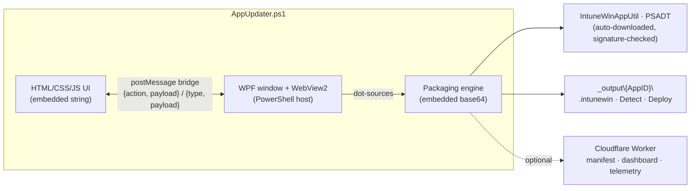

1. **Startup** — the script self-elevates, fetches the pinned WebView2 SDK from nuget.org into `wv2\` if missing (and installs the WebView2 Runtime if the machine lacks it), decodes the embedded engine to a temp file and dot-sources it so all packaging functions are in scope.
2. **UI** — a borderless WPF window hosts a WebView2 control; the UI is loaded with `NavigateToString`, so there are no loose HTML files to tamper with.
3. **Bridge** — every button posts `{ action, payload }` to PowerShell (`build-package`, `get-fleet`, `browse-installer`, …). The host runs the matching handler and replies with `{ type, payload }` messages (`build-progress`, `build-log`, `build-done`, `fleet-data`, …) that the page renders.
4. **Build** — the engine inspects the installer, writes the deploy and detect scripts, updates the manifest (local `appVersions.xml` or Cloudflare KV), and wraps the result as `.intunewin` or a PSADT package. Progress streams back live to the progress screen.
5. **On the device** — Intune runs the deploy script, which installs a scheduled task that checks the manifest and updates the app, so new versions roll out without rebuilding the package.

---

## Quick Start

### Prerequisites

| | |
|---|---|
| **OS** | Windows 10 or Windows 11 |
| **PowerShell** | 5.1 or later *(already installed on all modern Windows)* |
| **Admin rights** | Required for ACL enforcement and Credential Manager access |
| **Cloudflare account** | Optional — cloud-connected mode only |

> [!NOTE]
> `IntuneWinAppUtil.exe` and `PSAppDeployToolkit` are **automatically downloaded and verified** on first use. You do not need to install or find them manually.

### Launch

```powershell
# Right-click → Run with PowerShell, or from a console:
.\AppUpdater.ps1
```

It re-launches itself elevated (UAC prompt), downloads the WebView2 SDK into `wv2\` on first run, and opens the app. Everything else — IntuneWinAppUtil, PSADT, the packaging engine — is either embedded or fetched on demand.

### First Launch

On first run a **guided tour** walks through each screen (Escape / arrow keys / Enter to navigate). It can be replayed any time from **Docs & help → Replay tour**.

- You start in **offline mode** — packages build locally and the manifest is `appVersions.xml`.
- To go cloud-connected, open **Worker & settings → Connect to Cloudflare**. A 4-step walkthrough inside the app explains what the worker gives you, takes the API token, account and status page password, then deploys the worker with a live log. Two-step sign-in (TOTP) can be added afterwards.
- The first time you choose **EPM rule** in the builder, a spotlight explains each part of the screen and where EPM lives afterwards (**App fleet → EPM**).
- Set your **organisation name** (shown in end-user popups) under Worker & settings, or per-client in **Client profiles**.

> [!IMPORTANT]
> Settings are saved to `.appupdater-config` with SYSTEM + Administrators–only ACLs.

---

## Application Flow

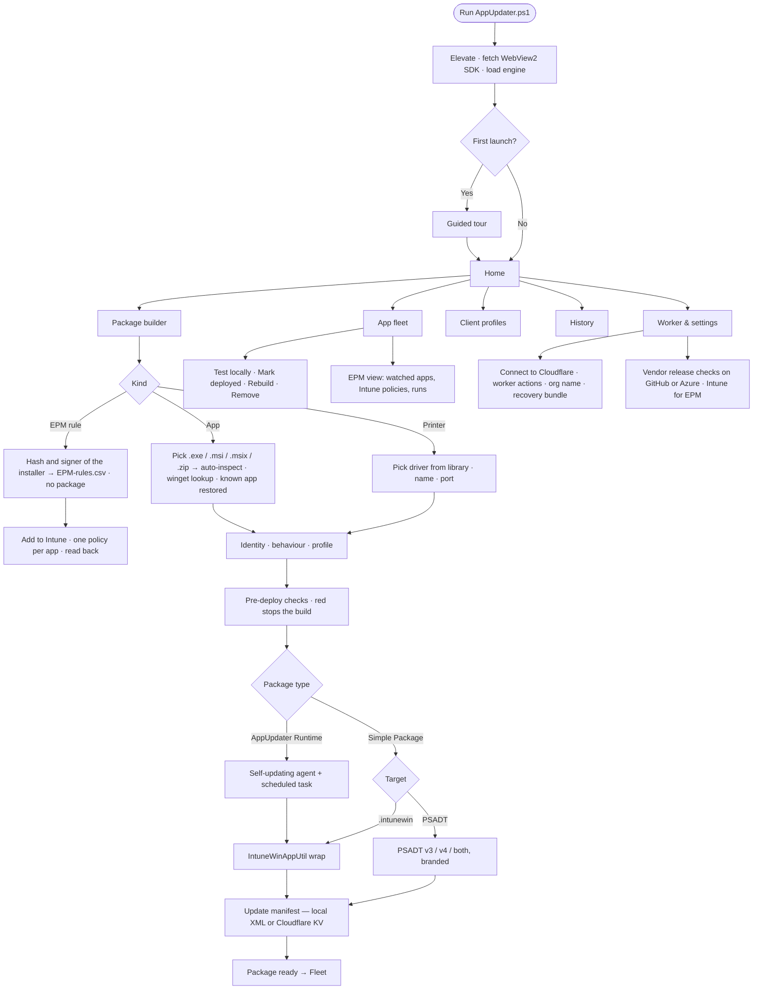

The pipeline rail at the top of the builder tracks the same stages: **Source → Identity → Configure → Wrap → Deliver**.

---

## The Interface

A borderless window with a left sidebar. Every screen is part of the same page, so switching is instant.

| Screen | What it's for |
|---|---|
| **Home** | Fleet stats (total / deployed / updates / pending), recent activity, getting-started checklist, shortcut to build, and a card asking whether apps deployed since the last launch installed correctly |
| **Package builder** | Choose **An app** or **A printer**; for an app, **Intune app**, **EPM rule** or **PSADT app**, and whether it **updates itself** or **you push updates**. Drop or browse an installer, review the auto-detected identity, live PSADT v3/v4 branding preview, **Build**. Below 1240px wide the manifest panel moves under the form |
| **App fleet** | Every app in the manifest with version, target, status badge and a note when winget has a newer version; filter, bulk-select, **Test locally** (with suggested fixes and a winget-pkgs contribution), **Mark deployed**, **Rebuild**, **Open folder**, **Remove**. The **EPM** filter shows EPM apps next to your Intune EPM policies, with **Add to Intune**, the vendor check **Runs** and **Set up**. Below 1240px wide the version history column is hidden so app names keep their room |
| **Client profiles** | Named branding sets (org name, logo, banner, default target) applied per build — handy for MSPs |
| **History** | Timeline of every build, deploy and removal |
| **Worker & settings** | Connect Cloudflare and run every worker action, open the status dashboard, default org name, recovery bundle export/import, online lookups (release check, winget, CISA), the opt-in NIST vulnerability check, display options (reduce motion, high contrast, colour-blind safe palette with shape cues), Home and tour options, **08 Vendor release checks** (where checks run, expected cost, Remove from Azure) and **09 Intune for EPM** (connect, and the switch that lets AppUpdater add rules) |
| **Docs & help** | How AppUpdater works, a link to the source and issues, and **Replay tour** |

Keyboard: <kbd>Tab</kbd> / <kbd>Shift</kbd>+<kbd>Tab</kbd> with a visible focus ring everywhere, <kbd>Esc</kbd> closes dialogs, arrow keys / <kbd>Enter</kbd> drive the tour, <kbd>Ctrl</kbd>+<kbd>K</kbd> opens the command search (every screen and action, including **Fleet: EPM apps and Intune**).

Every confirmation, choice and setup step is an in-app dialog drawn over the current screen; AppUpdater opens no separate windows of its own.

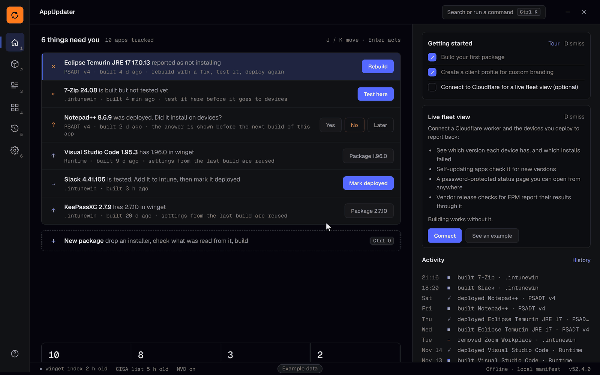

---

## Building a Package

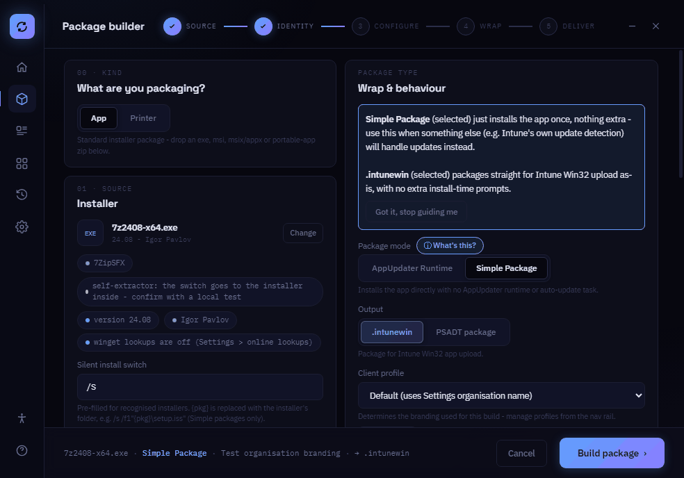

### Phase 1 — Pick Your Installer

- Click the drop zone in **Package builder** to browse for an `.exe`, `.msi`, `.msix`/`.appx` (and bundles) or a portable `.zip`
- The installer family (NSIS, Inno, WiX/Burn, InstallShield, Squirrel, Advanced Installer, InstallAware, 7-Zip SFX and more) is detected from the file; unknown installers ask for their silent switch instead of guessing
- An installer of an app packaged before is recognised by its MSI upgrade code, winget package or name and publisher, and the last build's settings are filled in again

### Phase 2 — Auto-Detection

AppUpdater inspects the installer and pre-fills every field. All fields are editable before building.

| Field | How it's determined |
|---|---|
| **App ID** | Derived from the product name without versions or architectures, so the next version keeps the same ID |
| **Display Name** | Read from file description metadata |
| **Silent Args** | From the winget catalogue when it lists the installer, otherwise from the installer family — MSI always gets `/qn /norestart` |
| **Registry Display Name** | From the winget catalogue or the installer; a local test suggests the name the app really registers |
| **Processes to Kill** | Executable names found alongside the installer; shell and system processes are never closed |

### Phase 3 — App Form

<details>
<summary><strong>Full list of form fields — click to expand</strong></summary>

**Core Identity**

| Field | Required | Notes |
|---|---|---|
| App ID | Yes | Alphanumeric + `. _ -`, ≤ 64 chars. Locked once the app exists in the manifest |
| Display Name | Yes | Shown in the desktop shortcut and update popups |

**Download**

| Field | Required | Notes |
|---|---|---|
| Primary Download URL | Yes | HTTPS only. The download is Authenticode-verified before install |
| Fallback URL | No | HTTPS only. Used if primary fails |

**Installation**

| Field | Required | Notes |
|---|---|---|
| Silent Install Arguments | Yes | e.g. `/quiet /norestart`. Auto-detected for MSIs |
| Registry Display Name | Yes | Must exactly match the entry in **Add or Remove Programs** — used in the detection script |

**Advanced** *(auto-detected, optional to change)*

| Field | Notes |
|---|---|
| Processes to Kill | Comma-separated exe names (no `.exe`). Closed before install runs |
| Launch exe after install | Path to exe to open when install completes |
| Expected Publisher | Authenticode signer CN — verified on every device download |
| SHA-256 Hash | 64 hex chars. Enables hash check before install. Offline packages only |

**Simple packages**

| Field | Notes |
|---|---|
| Minimum version for detection | Older copies count as not installed, so Intune upgrades them. A local test reads the version the app registers and offers it |
| Bundle the whole folder | Ships every file next to the installer; `{pkg}` in the silent switch stands for that folder |
| Remove older versions first | For apps that install side by side, such as Java. Needs the minimum version |
| Scripts | Before-install, after-install and after-uninstall PowerShell scripts for configuration the installer cannot do |

**Package Type**

| Type | Behaviour |
|---|---|
| **Runtime** *(default)* | Installs a self-updating agent: scheduled task, logs, desktop shortcut. App keeps itself current |
| **Simple** | Bundles the installer directly — one-shot install, no runtime components left on the device |

</details>

### Phase 4 — What you get

The two questions at the top of the builder decide the output. **What do you need?**

| Option | What happens |
|---|---|
| **Intune app** | Downloads `IntuneWinAppUtil.exe` from Microsoft's GitHub (first use only), verifies its Authenticode signature, and wraps the package as a `.intunewin` ready for upload |
| **PSADT app** | Downloads and caches `PSAppDeployToolkit` (first use only) and wraps the install in PSADT v3, v4 or both, with your branding, for close-apps prompts and the toolkit's end-user dialogs |
| **EPM rule** | No package: writes `EPM-rules.csv` (file name, SHA-256, signer) to `_output\{AppID}-EPM\` and shows the values to copy into Intune, or **Add it to Intune for me** — see [Endpoint Privilege Management](#endpoint-privilege-management-epm) |

**How does it stay up to date?**

| Option | What happens |
|---|---|
| **Updates itself** (Runtime) | The package installs a small agent that checks the manifest and installs new versions, so the next version needs no new package |
| **You push updates** (Simple) | The package installs this version only; build and upload a new one for the next version |

Output lands under `C:\ProgramData\AppUpdater\_output\`, and **Open folder** in Fleet goes straight there.


> [!NOTE]
> `IntuneWinAppUtil.exe` is downloaded from `https://github.com/microsoft/Microsoft-Win32-Content-Prep-Tool` on first use, verified against Microsoft's Authenticode certificate, then reused from the script directory. **No manual download required.**

### Pre-deploy Checks

Before every build the installer is checked. Red findings stop the build until you choose **Build anyway**; amber findings are shown with the finished package.

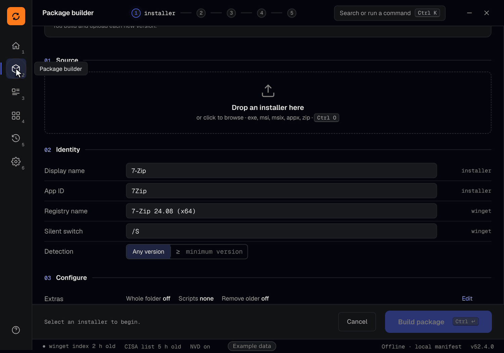

| Level | Finding |
|---|---|
| Red | The signature does not match the file, a previously signed app arrives unsigned, the signer changed, or the file's SHA-256 differs from winget's listing for that version |
| Amber | Unsigned installer, version not newer than the last package, newer version in winget, last deployment reported as failed, CISA known-exploited product, NIST NVD CVEs for the exact version (opt-in in Settings) |

### Local Test and Follow-ups

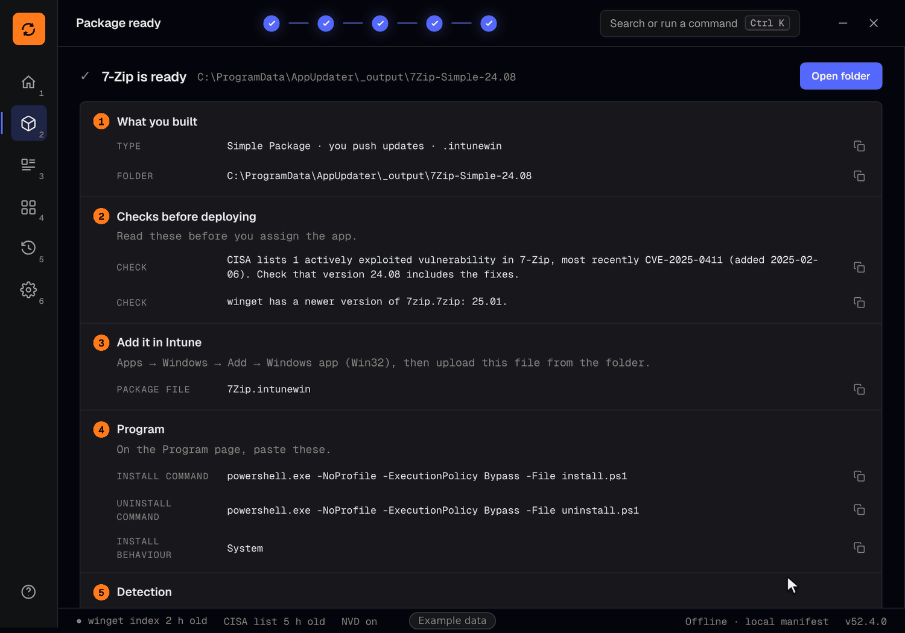

**Test locally** in Fleet installs, detects and uninstalls the package on this machine as SYSTEM, or as the user for per-user installers, and reports the Add/Remove Programs entries it created. From there AppUpdater can:

- Suggest the registry name the app really registers, and for Runtime packages the name the agent looks for
- Offer the registered version as the minimum version for detection
- Add the installed program and its updaters to `EPM-rules.csv` (SHA-256, signer certificate) for Intune Endpoint Privilege Management rules
- Contribute what it verified to [winget-pkgs](https://github.com/microsoft/winget-pkgs) as a pull request from your GitHub account, through Microsoft's `wingetcreate`

On the next launch, apps marked deployed ask whether they installed correctly; a "no" becomes a warning on the next package of that app.

### Phase 5 — Manifest Update

After every build, AppUpdater automatically:

- Merges the app entry into `appVersions.xml`
- If Cloudflare-connected: pushes the updated manifest to the Worker via `POST /manifest` (bearer-authenticated)
- Stores a standalone `XMLEntry-{AppID}.xml` in the output folder

---

## Endpoint Privilege Management (EPM)

Intune Endpoint Privilege Management lets standard users run one approved installer elevated, without making them local administrators. Each rule matches one exact file, so **every new version of an installer needs its own rule**. AppUpdater builds the rule, can write it into Intune for you, and can watch the vendor so the next version's rule is ready without anyone downloading it.

EPM itself needs an Intune Suite or EPM add-on licence (Microsoft offers a free 90-day trial). Building rules needs no licence, tenant or cloud account.

### Building a rule

Choose **What do you need? → EPM rule** in the builder and pick the installer. The first time, a spotlight walks through each part of the screen. **Create EPM rule** then:

- Takes the installer's **SHA-256** and its **signer certificate**
- Writes `EPM-rules.csv` to `C:\ProgramData\AppUpdater\_output\{AppID}-EPM\`; no `.intunewin`, scripts or manifest entry are made
- Shows the policy name (`EPM · {App name}`), file name, SHA-256 and rule type with copy buttons, plus **Add it to Intune for me** and **Watch for new versions**

Signed installers get a publisher-and-file-name rule that keeps matching after updates; unsigned ones get a file-hash rule.

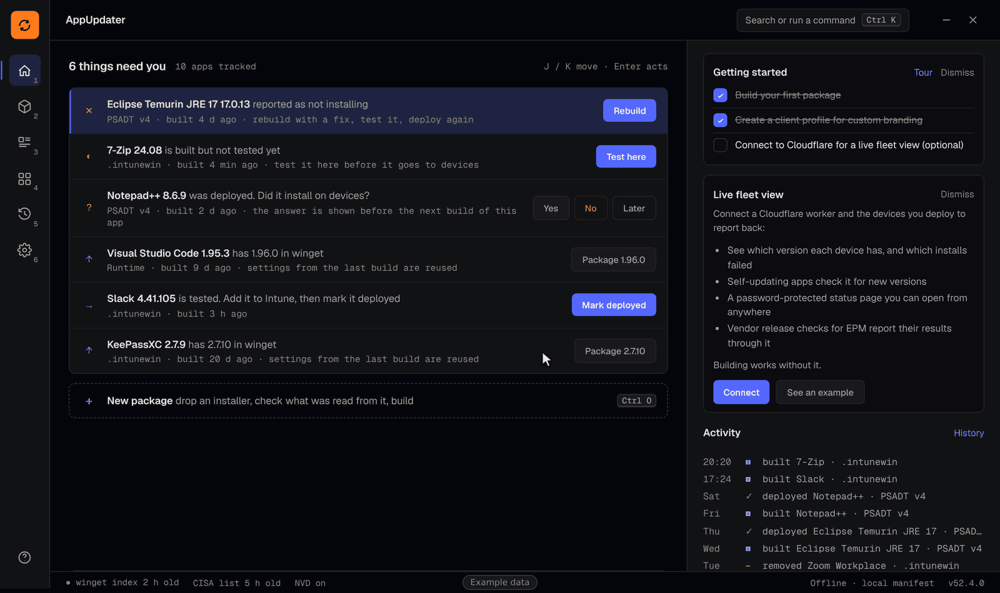

### Add to Intune

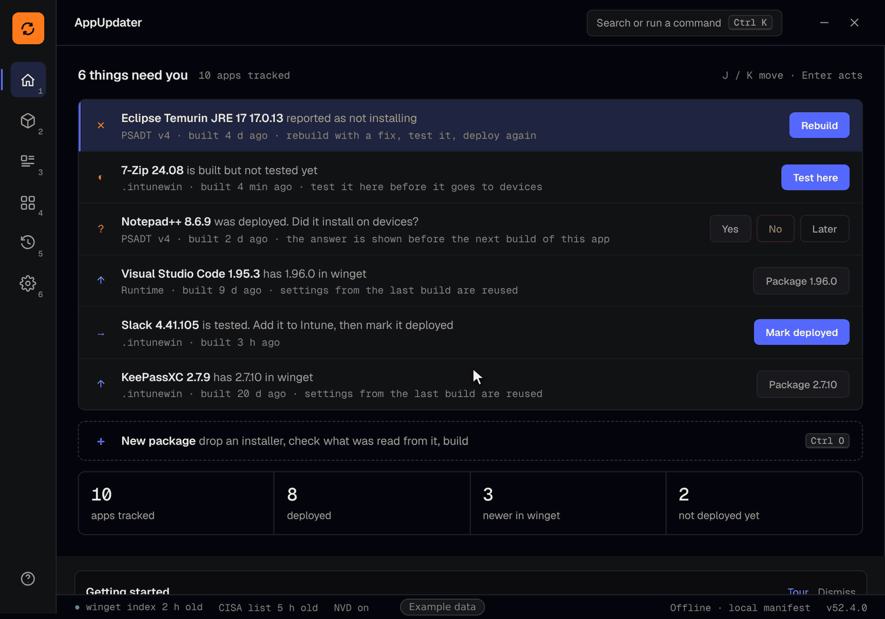

Adding rules is **off** until you switch it on in **Settings → 09 Intune for EPM**. Then **Add to Intune** (on the finished rule, or on any verified version in **App fleet → EPM**):

1. **Connect Intune.** Sign-in uses Microsoft's own *Microsoft Graph Command Line Tools* app with a device code, so nothing is registered in your tenant; an administrator may need to approve it once. It needs an Intune Administrator or Endpoint Security Manager account. The sign-in is held in memory for this session only.
2. **Find or create the app's policy.** AppUpdater keeps **one elevation rules policy per app**. If the hash is already in a policy it says so and stops. A new policy is assigned once, to an Entra group you search for, all users or all devices.
3. **Keep one previous version.** The newest existing rule for the app stays so devices that haven't updated still work; older ones are offered for removal, ticked by default.
4. **Preview.** The dialog shows the policy, rule name, file name, SHA-256 and signer, and asks whether users confirm the elevation (*They confirm it*) or it runs elevated straight away.
5. **Write and read back.** The whole policy is written, then read back from Intune and every value compared with what was meant to be written. Each step appears in a live log.

The SHA-256 and file name always come from AppUpdater's own records (the build's `EPM-rules.csv` or the vendor check results), never from the page. If you built another app since, Add to Intune refuses and asks you to rebuild instead of writing the wrong file.

Connected, **App fleet → EPM** lists your elevation rules policies with their assignments and rules, marks the ones AppUpdater watches, warns when a policy nears Intune's 100-rule limit and when no elevation settings policy turns EPM on for devices.

> [!WARNING]
> Writing to EPM policies has been tested against Microsoft Graph's documented format with recorded responses, not yet against every tenant. Try it on a test tenant first if you can.

### Vendor release checks

A **hosted machine** is created for each run, checks the vendor and is deleted. Nothing downloads on your PC.

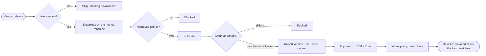

Each watched app names its source (a GitHub release, a redirect link or a vendor page with a version pattern) and its approved publisher. A file signed by anyone else, or whose hash differs from winget's listing for the same version, is blocked and never reaches Intune.

**Where checks run:**

| | GitHub | Azure |
|---|---|---|
| **What is created** | A private repo in your GitHub account with the check workflow | One resource group, `appupdater-epm`: an Automation account with its own managed identity, a storage account with one private container, the check runbook on a 6-hour schedule |
| **New versions reach Intune** | When you click **Add to Intune** | By themselves: the runbook adds each verified version to the app's policy and reads it back |
| **Results come back** | Through your Cloudflare worker; the workflow proves itself with GitHub's OIDC token, which the worker checks against your repo | Straight from the storage container, with a key limited to that container |
| **Cost** | Free: private repos get 2,000 Actions minutes a month; this uses about 15 to 60 | Expected **$0 to $0.05 a month**: Automation includes 500 free job minutes, this uses about 120 to 250; storage for a few KB costs pennies a year. Needs an Azure subscription, which asks for a card |
| **Needs** | A GitHub account and the Cloudflare worker | The Owner role on a subscription, and a Global or Privileged Role Administrator to approve one Intune permission |

> [!IMPORTANT]
> Prices vary by region and can change. Review them yourself on [Azure's Automation pricing page](https://azure.microsoft.com/pricing/details/automation/) (the **Azure pricing** button opens it) and keep an eye on your Azure bill. Settings shows the expected cost while Azure is set up.

> [!NOTE]
> The GitHub machine needs AppUpdater's GitHub sign-in, which is not switched on in this release, so choosing GitHub says *This build has no GitHub sign-in configured*. Azure works now.

**The Azure walkthrough** (Settings → 08 → **Set up…** → Azure, or the EPM setup screen):

| Step | What happens |
|---|---|
| **1 — What it creates** | The resources, what each costs and the expected total, with a reminder to review the prices yourself |
| **2 — Sign in** | Device-code sign-in with Microsoft's Azure PowerShell app, as an account that owns the subscription |
| **3 — Subscription and region** | Choose an enabled subscription and a region near you |
| **4 — Create, then approve** | Registers the Automation and Storage providers, creates the resource group, storage, Automation account, runbook and schedule, and gives the identity *Storage Blob Data Contributor* on that one account. Then an admin signs in once to grant the identity Microsoft Graph `DeviceManagementConfiguration.ReadWrite.All` and nothing else |
| **5 — Test** | Starts the runbook once, waits for it (usually 2 to 5 minutes) and reads the result back |

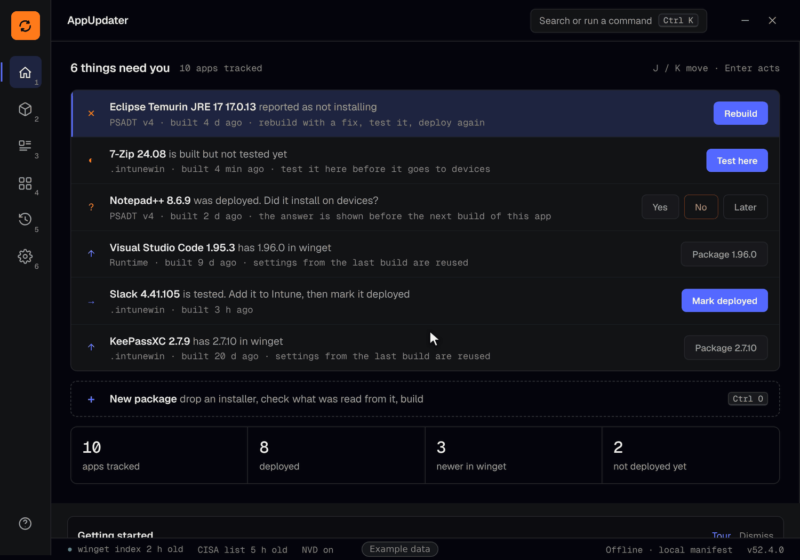

**Remove from Azure** deletes the resource group and everything in it, and the container key on this PC. Your Intune policies are not touched.

### Runs

**App fleet → EPM → Runs** lists the last checks (Azure keeps 30). Each line says what happened to each app and why: *26.07 verified, signed by Igor Pavlov; added to Dev Tools EPM and read back*, *No new version; download skipped*, *Signed by 'Unknown Ltd', not the approved publisher*.

### Setup screen

**App fleet → EPM → Set up** (or **Set up** in the empty EPM view) is the one place with **Start** and **Skip setup**. It lists the three parts, **Connect Intune**, **Let AppUpdater add rules** and **Watch for new versions (optional)**, and a map that runs example versions along the GitHub and Azure lines. **Start** takes you through each part in turn and tests it (the Intune policies are read, the permission is checked, the check machine runs once) before moving on. A part that doesn't pass says why and offers **Try again**. None of them is needed to build EPM rules.

---

## Generated Artifacts

### Build Machine Output

All files land in `C:\ProgramData\AppUpdater\_output\{AppID}\`:

| File | Package | Description |
|---|---|---|
| `{AppID}.intunewin` | Updates itself | Intune Win32 package — upload directly to the Intune portal |
| `{AppID}-Simple.intunewin` | You push updates | The same, for a Simple package; PSADT builds go to their own `_output\{AppID}-Simple-PSADT-v3\` (or `-v4\`) folder |
| `Detect-{AppID}.ps1` | Updates itself | Detection script — exits `0` if deployed, `1` if not |
| `Deploy-{AppID}.ps1` | Updates itself | Deployment script — runs as SYSTEM via Intune |
| `XMLEntry-{AppID}.xml` | Updates itself | Standalone manifest entry for this single app |
| `install.ps1` · `uninstall.ps1` | You push updates | Install and uninstall commands for the Intune app |
| `detect.ps1` | You push updates | Detection script — finds the Add/Remove Programs entry and checks the minimum version |

### Detection Logic

For **Updates itself** packages:

```powershell
# Detect-{AppID}.ps1 — generated by AppUpdater
$taskExists   = Get-ScheduledTask -TaskName 'AppUpdater-{AppID}' -ErrorAction SilentlyContinue
$scriptExists = Test-Path 'C:\ProgramData\AppUpdater\{AppID}\{AppID}.ps1'

if ($taskExists -and $scriptExists) { Write-Host 'Detected'; exit 0 } else { exit 1 }
```

Both the **scheduled task** and the **script file** must exist for detection to pass.

For **You push updates** packages, `detect.ps1` looks for the **Registry Display Name** under the machine and per-user uninstall keys. With a minimum version set, an older copy counts as not installed, so Intune upgrades it.

### Deploy Script — What it Does on the Device

<details>
<summary><strong>All 8 deploy phases (Updates itself packages) — click to expand</strong></summary>

The generated `Deploy-{AppID}.ps1` runs as **SYSTEM** via Intune and performs these phases in order:

**Phase 1 — Enable audit logging**

Enables PowerShell Script Block Logging (`HKLM:\SOFTWARE\Policies\Microsoft\Windows\PowerShell\ScriptBlockLogging`) so every PowerShell line executed on the device is written to the Windows Event Log (Event ID 4104) for forensic audit.

**Phase 2 — Create folder structure with ACLs**

Creates `C:\ProgramData\AppUpdater\{AppID}\` and `logs\` with strict NTFS permissions enforced via `takeown` and `icacls`:

| Principal | Rights |
|---|---|
| `NT AUTHORITY\SYSTEM` | Full control (OI CI F) |
| `BUILTIN\Administrators` | Full control (OI CI F) |
| `BUILTIN\Users` | Read & Execute (OI CI RX) |

**Phase 3 — Write the update script**

Decodes and writes the base64-embedded `{AppID}.ps1` (the combined auto-update + UI script) to `C:\ProgramData\AppUpdater\{AppID}\`.

**Phase 4 — Create log files with restricted ACLs**

| File | Access |
|---|---|
| `update-detail.log` | SYSTEM + Administrators only — full verbose transcript |
| `update-status.log` | User-readable — sanitised status lines |
| `update-task-run.log` | User-readable — run timestamps and outcomes |

**Phase 5 — Create staging folder**

Creates `C:\ProgramData\AppUpdater\{AppID}\staging\` accessible only by SYSTEM and Administrators. Downloaded installers land here temporarily and are cleared after each run.

**Phase 6 — Register the scheduled task**

| Setting | Value |
|---|---|
| Task name | `AppUpdater-{AppID}` |
| Runs as | `NT AUTHORITY\SYSTEM` |
| Run level | Highest |
| Execution policy | `RemoteSigned` |
| Timeout | 2 hours |
| Battery behaviour | AllowStartIfOnBatteries |

**Phase 7 — Grant users task-trigger rights**

Applies a COM DACL to the scheduled task so standard users can trigger it without UAC elevation. Uses a 15-second retry loop in case Task Scheduler is momentarily busy.

**Phase 8 — Create desktop shortcut**

Creates `C:\Users\Public\Desktop\Update {DisplayName}.lnk`. Falls back to the current user's desktop if Public Desktop is inaccessible.

| Property | Value |
|---|---|
| Target | `powershell.exe -NoProfile -ExecutionPolicy RemoteSigned -File "{AppDir}\{AppID}.ps1"` |
| Icon | `shell32.dll,270` |
| Description | `Checks and updates {DisplayName} — no admin rights needed` |

</details>

### Target Device Runtime Paths

| Path | Purpose |
|---|---|
| `C:\ProgramData\AppUpdater\{AppID}\{AppID}.ps1` | Auto-update + UI script, persists on device |
| `C:\ProgramData\AppUpdater\{AppID}\logs\update-detail.log` | Full verbose log (admin-only) |
| `C:\ProgramData\AppUpdater\{AppID}\logs\update-status.log` | Sanitised status (user-readable) |
| `C:\ProgramData\AppUpdater\{AppID}\logs\update-task-run.log` | Run timestamps & outcomes (user-readable) |
| `C:\ProgramData\AppUpdater\{AppID}\staging\` | Temporary download area, cleared after each run |
| `C:\Users\Public\Desktop\Update {DisplayName}.lnk` | Desktop shortcut — no admin required |
| Scheduled Task `AppUpdater-{AppID}` | SYSTEM-level task, user-triggerable without UAC |

---

## Printer Packages

Alongside the standard `.exe`/`.msi` installer path, the builder's **What are you packaging?**
question also offers **A printer** — deploys a printer queue, driver, and port via native Windows
printer cmdlets (`Add-PrinterDriver`, `Add-PrinterPort`, `Add-Printer`) instead of running
an installer. No `.exe`/`.msi` needed at all.

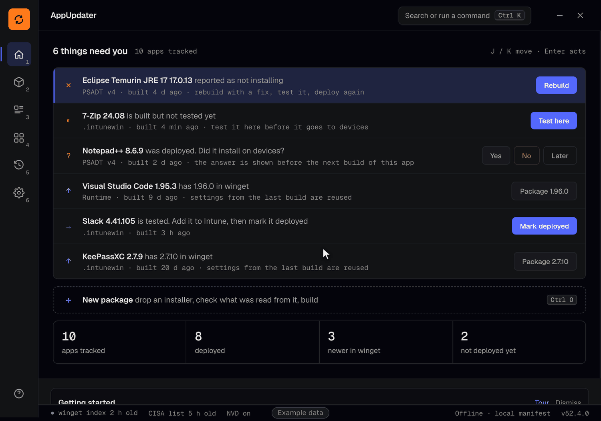

### Driver Library

Rather than re-supplying a driver source on every build, AppUpdater keeps a local
**driver library** (`driverLibrary.json`, next to the script — same "shareable JSON index"
pattern as `appVersions.xml`). Each entry is Authenticode-verified against its expected
publisher at import time and extracted once under `C:\ProgramData\AppUpdater\_drivers\{DriverID}\`.

Some driver packages cover a whole product family from one INF (e.g. Brother's HL-series
driver installs 18 different printer models). For those, a library entry can carry a
**Models** list — picking a model in the Printer build form auto-fills the driver name
without needing a separate library entry per model.

### Built-in Driver Families

The **Import built-in driver families** button (Printer build step, next to *+ Add driver
to library*) seeds the library with 11 curated vendor families in one click:

| Manufacturer | Families |
|---|---|
| Brother | HL Series (18 models), TD Series (6 models) |
| Fuji Xerox | PrimeLink C9000 Series, ApeosPort Series |
| HP | LaserJet Pro M304/M305/M404/M405, Color LaserJet Pro M478f/M479, generic Universal Printing PCL 6 |
| Canon | Generic Plus PCL6 |
| Ricoh | MP Series, P Series, SP Series |

> [!NOTE]
> This seeds **metadata only** — driver IDs, display names, and INF filenames — not the
> vendor driver `.zip` files themselves (third-party binaries aren't bundled). A seeded
> entry shows **"driver files not yet supplied"** in the driver dropdown and is blocked
> from building until you supply the real driver package for that `DriverID` via
> **+ Add driver to library** (same ID, so it fills in over the seeded metadata without
> losing it). Safe to click more than once — re-importing never overwrites a driver file
> you've already supplied.

### Generated Artifacts (Printer packages)

| File | Description |
|---|---|
| `printer-config.json` | Printer name, driver name/INF, port, location — read by all three scripts below |
| `Install-Printer.ps1` | Idempotent installer: registers the driver, creates the port, creates/corrects the printer |
| `Detect-Printer.ps1` | Verifies Spooler is running, then that the printer exists with the expected driver/port — distinguishes "not installed" from "Spooler down" rather than throwing on both |
| `Uninstall-Printer.ps1` | Removes the printer queue, and the port/driver too if nothing else on the device still uses them |

These three scripts are static and embedded in `AppUpdater.ps1` itself (not downloaded), so they
carry no separate Authenticode burden — only the driver *payload* they operate on is
verified, inside `Install-Printer.ps1`.

---

## Cloudflare Mode

Cloudflare mode adds a web dashboard, per-device telemetry, and centralised manifest hosting — all on Cloudflare's free tier. AppUpdater deploys the Worker automatically from your API token.

### Connecting

Open **Worker & settings → Connect to Cloudflare** (or **Connect** on Home). Four steps run inside the app:

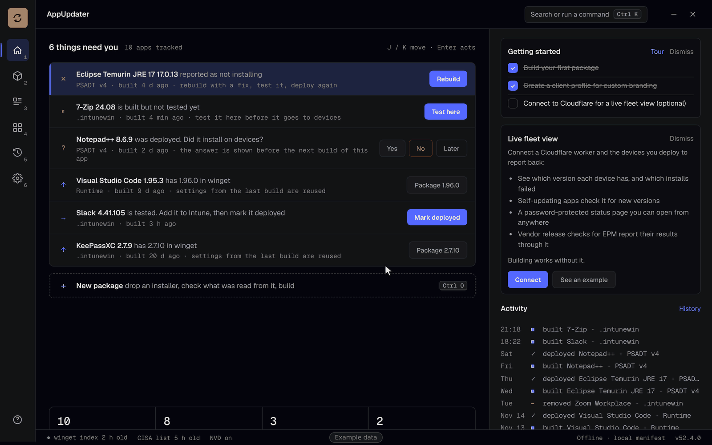

| Step | What you do |
|---|---|
| **1 — Why** | What a worker adds: live fleet, self-updating apps, the status page, EPM vendor checks. Building works without it |
| **2 — API token** | **Open Cloudflare token page**, create a token from the *Edit Cloudflare Workers* template, paste it. **Check token** verifies it and lists your accounts; a rejected token says why and lets you try again |
| **3 — Account and status page** | Pick the account (if you have more than one), your organisation name, and the status page password (12+ characters with a letter and a digit). The password goes straight to the worker |
| **4 — Setup** | The automated setup below runs in the background with a live log. The token and password exist only in that background job and are not saved |

> [!IMPORTANT]
> You only need a Cloudflare API token; everything else is automated.

**Required API token scopes:**

| Permission | Level |
|---|---|
| Workers Scripts | Edit |
| Workers KV Storage | Edit |
| Account Settings | Read |

Create your token at [dash.cloudflare.com/profile/api-tokens →](https://dash.cloudflare.com/profile/api-tokens)

<details>
<summary><strong>What the automated setup does — click to expand</strong></summary>

| Step | What happens |
|---|---|
| **1 / 7 — API Token** | Token validated against `/user/tokens/verify`. Stored in Windows Credential Manager (SYSTEM + Admins only) |
| **2 / 7 — Account** | Fetches your Cloudflare accounts. If you have more than one, a picker appears. Account ID stored for all subsequent calls |
| **3 / 7 — Domain** | Fetches your zones. Use the free `*.workers.dev` URL or choose a custom domain + subdomain (default: `updates`) |
| **4 / 7 — KV Namespace** | Creates (or finds) the `AppUpdater-Manifest` KV namespace that stores app data, sessions, and secrets |
| **5 / 7 — Deploy Worker** | Uploads the embedded JavaScript Worker via multipart form, binds the KV namespace, enables `workers.dev` routing, stores the bearer token as Worker Secret `AUTH_TOKEN`, and schedules an hourly health-check cron |
| **6 / 7 — Resolve URL** | Gets your Worker URL. If using a custom domain, provisions the Workers Custom Domain and waits for certificate issuance |
| **7 / 7 — Auth & Telemetry** | Generates a 32-byte session secret (stored in KV) and a 32-byte event-telemetry secret (stored as Worker Secret `EVTSEC`). Uploads the starter manifest. Opens the dashboard for first-time password setup |

After setup, a `HOW TO USE.txt` file is written to the script directory with your Worker URL and next steps.

</details>

### Worker actions

Once connected, **Worker & settings → 01** lists every action. Each opens an in-app dialog, and the ones that change Cloudflare run in the background with a live log. The Cloudflare API token is asked for each time and not saved.

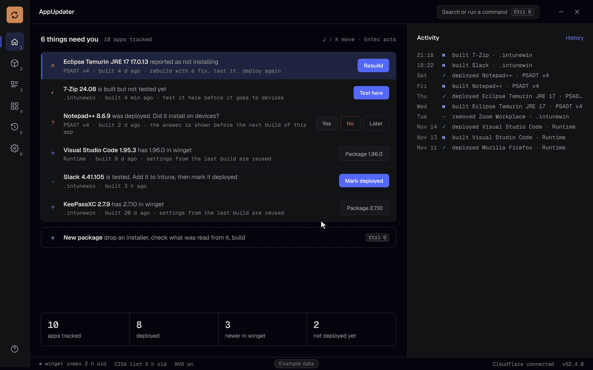

| Action | What it does |
|---|---|
| **Re-deploy** | Uploads this version's worker, rotates the event secret and re-sends your app list. Do this after updating AppUpdater |
| **Use your own domain** | Serves the worker from a domain on your Cloudflare account, e.g. `updates.yourcompany.com`; the `workers.dev` address stays as the fallback |
| **Reset the status page password** | Clears the password and signs out every browser; you choose a new one on the status page |
| **Two-step sign-in** | Opens the status page's TOTP setup in your browser |
| **Change the worker address** | Only for a domain set up outside AppUpdater |
| **Rotate the manifest token** | New secret for this PC and the worker; the old one stops working at once |
| **Disconnect** | *This PC only* (the worker keeps running) or *delete the worker* and its data from Cloudflare, confirmed by typing the worker name |

### What's on the Dashboard

After authenticating at `https://{your-worker}.workers.dev/status`:

- **App list** — every app in the manifest with version and last-seen date
- **Per-device telemetry** — which devices have checked in, last run time, success/failure
- **Per-app detail view** — full event log for each enrolled device
- **Session management** — log out all sessions from any device

### Worker API Reference

<details>
<summary><strong>All 23 endpoints — click to expand</strong></summary>

**Authentication types:**

- **Session cookie** — HMAC-SHA256 signed, browser / dashboard flows
- **Bearer token** — `X-Auth-Token` header, PowerShell machine-to-Worker calls
- **App secret** — per-app HMAC telemetry secret, embedded in deploy scripts
- **GitHub OIDC** — a GitHub Actions ID token, accepted only from the repo and workflow the build machine registered

| Method | Endpoint | Auth | Description |
|---|---|---|---|
| `GET` | `/health` | None | Liveness check — returns `200 OK` |
| `GET` | `/login` | None | Render login page |
| `POST` | `/login` | None | Submit password + TOTP (if enrolled). Rate-limited: 15 attempts/IP/15 min |
| `POST` | `/logout` | Session | Invalidate current session |
| `POST` | `/logout-all` | Session | Invalidate **all** active sessions across all devices |
| `GET` | `/set-password` | None | First-run password setup page |
| `POST` | `/set-password` | None | Save initial dashboard password |
| `GET` | `/change-password` | Session | Change password form |
| `POST` | `/change-password` | Session | Update dashboard password |
| `GET` | `/totp-setup` | Session | TOTP enrollment page with QR code |
| `POST` | `/totp-setup` | Session | Confirm TOTP enrollment with a valid code |
| `POST` | `/totp-disable` | Session | Remove TOTP requirement |
| `GET` | `/status` | Session | Main dashboard — app list + device telemetry |
| `GET` | `/app/{id}` | Session | Per-app detail view and event log |
| `POST` | `/manifest` | Bearer | Upload or replace the full app manifest |
| `DELETE` | `/app/{id}` | Bearer | Remove an app and all its telemetry data |
| `GET` | `/deploy/{id}` | None | Download deploy script for an app |
| `POST` | `/deploy-store/{id}` | Bearer | Push a generated deploy script from the build machine |
| `POST` | `/event` | App secret | Ingest a telemetry event from an enrolled device |
| `GET` | `/evtsec-export` | Bearer | Export the event HMAC secret (for embedding in scripts) |
| `GET` / `PUT` | `/epm/state` | Bearer | Read or update the watched apps, check settings, results and runs |
| `GET` | `/epm/apps` | GitHub OIDC | The watch list and last known versions, for the check workflow |
| `POST` | `/epm/result` | GitHub OIDC | The check workflow reports each app's version, file, SHA-256 and signer |

</details>

---

## Security

AppUpdater was designed for environments where endpoint security matters. Every secret has a defined storage mechanism, trust boundary, and rotation path.

### Security Model

| Component | Mechanism |
|---|---|
| **Bearer token** | Windows Credential Manager, target `AppUpdater-ManifestToken`, LocalMachine scope — DPAPI-backed, readable only by SYSTEM and local Administrators |
| **Dashboard password** | PBKDF2-SHA256, 100 000 iterations, stored only in Cloudflare KV (`auth_password`) — never transmitted in plaintext |
| **Session cookie** | HMAC-SHA256 signed, `HttpOnly`, `Secure`, `SameSite=Strict`, 24-hour `Max-Age` |
| **Login rate limiting** | 15 attempts per IP per 15 minutes, then refused until the window passes. Manifest uploads with the bearer token don't count |
| **TOTP** | RFC 6238 time-based OTP, secret stored in Cloudflare KV as `totp_secret` |
| **Event telemetry secret** | 32-byte random base64, per-app, auto-rotates on every Worker re-deploy |
| **Binary integrity** | Microsoft Authenticode signature verified before any downloaded `.exe` is executed |
| **Config file** | `.appupdater-config` locked to SYSTEM + Administrators via `icacls` — no standard user read access |
| **Script Block Logging** | Enabled at runtime on target devices — all PowerShell logged to Event ID 4104 |
| **Generated scripts** | NTFS ACL–enforced via `icacls` and `takeown` — no Authenticode signing |
| **Intune sign-in** | Device-code sign-in; the token is held in memory for the session and never saved or sent to the page. Read-only unless adding rules is switched on, and the permission is checked in the token itself |
| **EPM rule values** | The hash and file name written to Intune come from AppUpdater's own records, are validated, and are read back from Intune after writing |
| **Azure check machine** | A managed identity with Graph `DeviceManagementConfiguration.ReadWrite.All` only, and Storage Blob Data Contributor on its own storage account. AppUpdater's key is limited to one container, read/write/list, for one year, and lives in Windows Credential Manager (`AppUpdater-EpmAzureSas`) |
| **GitHub check machine** | Results are accepted only with a GitHub OIDC token for the registered repo and workflow; the GitHub sign-in token is used once to create the repo and is not kept |
| **Secrets in setup** | Cloudflare tokens and the status page password exist only inside the background job that uses them |

> [!WARNING]
> Local Administrators on the build machine can read the bearer token from Windows Credential Manager. Limit local admin access to the machine running AppUpdater accordingly.

### Bearer Token Rotation

The bearer token (`X-Auth-Token`) authenticates all PowerShell calls from the build machine to the Worker. To rotate it:

1. Open **Worker & settings → Rotate the manifest token → Rotate…**
2. AppUpdater generates a new token, stores it in Credential Manager, and updates the Worker Secret (`AUTH_TOKEN`) — all in one step, no manual Cloudflare configuration required

### Session Security

Sessions are HMAC-SHA256 signed with a 32-byte secret stored only in Cloudflare KV. The secret is generated during wizard setup and never exposed through the API. To invalidate all active sessions (e.g. after a suspected credential compromise), use **POST /logout-all** from the dashboard.

### Binary Verification

Every binary AppUpdater downloads — `IntuneWinAppUtil.exe`, app installers, PSADT archives — is verified before use:

- **Authenticode** signature must be present and valid
- **Publisher** must match the expected signer (configurable per-app via the *Expected Publisher* field)
- **TLS 1.2+** enforced for all downloads via `[Net.ServicePointManager]::SecurityProtocol`
- Any download that fails verification is deleted immediately and the operation is aborted

---

## Reference

### App Manifest Format

<details>
<summary><strong>appVersions.xml schema — click to expand</strong></summary>

```xml
<?xml version="1.0" encoding="UTF-8"?>
<AppManifest>
  <App>
    <!-- Required: unique identifier. Alphanumeric + ._- only, max 64 chars,
         must start with a letter or digit. Used as folder name, task name,
         and script filename on target devices. -->
    <ID>SevenZip</ID>

    <!-- Required: shown in desktop shortcut label and update popups on devices -->
    <DisplayName>7-Zip</DisplayName>

    <!-- Auto-populated after first build. Leave blank on creation. -->
    <Version></Version>

    <!-- Required: HTTPS direct-download link. Authenticode-verified on device before install. -->
    <DownloadURL>https://example.com/7z2301-x64.exe</DownloadURL>

    <!-- Optional: HTTPS fallback URL if primary fails -->
    <FallbackURL></FallbackURL>

    <!-- Required: silent install flags. MSIs always receive /qn /norestart automatically. -->
    <SilentArgs>/S</SilentArgs>

    <!-- Required: must exactly match the Add or Remove Programs display name.
         Used in the generated detection script registry check. -->
    <RegistryDisplayName>7-Zip</RegistryDisplayName>

    <!-- Optional: comma-separated exe names (no .exe extension) to close before install -->
    <ProcessesToKill>7zFM,7zG</ProcessesToKill>

    <!-- Optional: full path to exe to launch after install completes -->
    <LaunchExe></LaunchExe>
  </App>

  <!-- Add more <App> entries for additional applications -->
</AppManifest>
```

</details>

### Script Parameters

```powershell
.\AppUpdater.ps1 [-Wv2AssemblyDir <string>]
```

| Parameter / variable | Description |
|---|---|
| `-Wv2AssemblyDir` | Where the WebView2 SDK DLLs live (default `wv2\` next to the script). Downloaded there automatically if missing |
| `$env:APPUPDATER_DEBUG_PORT` | Opens a Chrome DevTools Protocol port on the WebView2 control — used by `click-test.ps1` |
| `$env:APPUPDATER_NO_ELEVATE` | Skips the UAC self-elevation (unattended test runs only; admin-only actions will fail) |

### Config File

AppUpdater saves its state to `.appupdater-config` (JSON) in the script directory, locked to SYSTEM + Administrators via `icacls`.

| Key | Description |
|---|---|
| `WorkerURL` | Cloudflare Worker URL (custom domain if configured) |
| `WorkerDevURL` | `*.workers.dev` fallback URL |
| `ManifestToken` | Set to `"CREDMGR"` — actual token lives in Windows Credential Manager |
| `AccountID` | Cloudflare Account ID |
| `OrgName` | Organisation name shown in device update popups |
| `SetupDate` | ISO 8601 timestamp of when the wizard last ran |
| `IntuneWriteEnabled` | `true` once **Let AppUpdater add rules to Intune** is switched on |
| `EpmRunner` | `azure` while vendor checks run on Azure |
| `EpmAzure` | Subscription, resource group, Automation account, storage account, identity and region of the Azure check machine |

### File & Path Reference

<details>
<summary><strong>All paths — click to expand</strong></summary>

**Build machine:**

| Path | Description |
|---|---|
| `$ScriptDir\.appupdater-config` | JSON config (SYSTEM + Admins only) |
| `$ScriptDir\appVersions.xml` | Local app manifest |
| `$ScriptDir\IntuneWinAppUtil.exe` | Auto-downloaded from Microsoft GitHub on first build |
| `$ScriptDir\PSAppDeployToolkit\` | Auto-downloaded & cached PSADT framework |
| `$ScriptDir\AppUpdater.log` | Full verbose session log |
| `$ScriptDir\Temp\{AppID}\` | Per-build temp files (cleaned after each run) |
| `$ScriptDir\HOW TO USE.txt` | Generated by Cloudflare wizard — Worker URL & next steps |
| `C:\ProgramData\AppUpdater\_output\{AppID}\` | Generated build artifacts |
| `C:\ProgramData\AppUpdater\_output\{AppID}-EPM\EPM-rules.csv` | EPM rule values for an EPM build |

**Windows Credential Manager:**

| Target | Description |
|---|---|
| `AppUpdater-ManifestToken` | Bearer token for all Worker API calls |
| `AppUpdater-EpmAzureSas` | Key for the Azure check machine's storage container |

**Target device** *(after `Deploy-{AppID}.ps1` runs)*:

| Path | Description |
|---|---|
| `C:\ProgramData\AppUpdater\{AppID}\{AppID}.ps1` | Auto-update + UI script |
| `C:\ProgramData\AppUpdater\{AppID}\logs\update-detail.log` | Admin-only verbose log |
| `C:\ProgramData\AppUpdater\{AppID}\logs\update-status.log` | User-readable status |
| `C:\ProgramData\AppUpdater\{AppID}\logs\update-task-run.log` | User-readable run log |
| `C:\ProgramData\AppUpdater\{AppID}\staging\` | Temporary download area |
| `C:\Users\Public\Desktop\Update {DisplayName}.lnk` | Desktop shortcut |
| Scheduled Task `AppUpdater-{AppID}` | SYSTEM task, user-triggerable without UAC |

</details>

### Logging

AppUpdater uses a three-tier logging system with different access controls at each tier:

| Tier | File | Access | Content |
|---|---|---|---|
| **Detail** | `AppUpdater.log` *(build machine)* | Admin-only | Full verbose trace of every operation |
| **Task-run** | `update-task-run.log` *(device)* | User-readable | Timestamps and outcomes per scheduled run |
| **Status** | `update-status.log` *(device)* | User-readable | Sanitised success/failure lines |

Console output on the build machine uses consistent prefixes:

| Prefix | Meaning |
|---|---|
| `[OK]` | Operation succeeded |
| `[!!]` | Non-fatal issue, continuing |
| `[XX]` | Operation failed — check detail log |
| `[--]` | Informational message |
| `[2/5]` | Progress through a multi-phase operation |

---

## Testing

`tests/reliability.ps1` runs the regression suite under PowerShell 7 and Windows PowerShell 5.1. The **real-installs** workflow downloads real vendor installers (listed in `tests/apps.json`), packages them and installs, detects and uninstalls each one as SYSTEM on a clean Windows runner. Every push covers each app as a Simple package plus upgrade, per-user, Java, dependency, printer, PSADT and Runtime scenarios; the weekly run also packages every app as PSADT v3, PSADT v4 and Runtime.

`click-test.ps1` drives the real app over the Chrome DevTools Protocol: it opens every screen, picks an installer, checks the build form in both modes and its guards, builds Simple and PSADT packages, runs a local install and uninstall as SYSTEM, re-packages a known app, triggers and overrides a pre-deploy block, answers the deployment feedback card and toggles settings. It also checks that the in-app dialogs are drawn on top and take clicks, that Cloudflare connect opens no native window, the EPM rule build (no package, the progress bar names the rule), the EPM spotlight and setup screen, and the choice of check machine with its costs. It saves a screenshot of each step, which the **click-test** workflow uploads as the `click-test-screenshots` artifact.

```powershell
.\click-test.ps1          # test against the host.ps1 next to it
.\click-test.ps1 -Reset   # wipe app state first for a repeatable run
```

It doesn't need admin rights. When it isn't elevated, it sets `APPUPDATER_NO_ELEVATE=1` so the run doesn't hang on a UAC prompt. The **click-test** GitHub Actions workflow runs it on every push, on `windows-latest` under Windows PowerShell 5.1, and installs the WebView2 Runtime first if the runner doesn't have it. Failures and the last lines of `AppUpdater.log` show up as run annotations.

> [!NOTE]
> Native Win32 dialogs such as the installer and image file pickers sit outside the WebView2 page, so this test doesn't cover them.

---

## Known Limitations

- **No log rotation** — `AppUpdater.log` appends indefinitely; prune manually if disk space is a concern
- **One copy per machine** — a second copy says *AppUpdater is already running* and closes
- **Windows-only** — depends on WPF, NTFS ACLs, DPAPI, and Windows Credential Manager; not portable to other platforms
- **Cloud requires internet** — the offline build path is fully functional, but dashboard, telemetry, and manifest sync are unavailable without connectivity
- **Generated scripts are not Authenticode-signed** — NTFS ACL enforcement is the only code integrity control on the deployment share
- **Vulnerability data is advisory** — CISA does not list affected versions and NVD's product data has gaps, so a clean result does not prove a version is safe
- **Removing older versions** runs only MSI removals and the vendor's own quiet uninstall command; other uninstallers are left in place
- **EPM writes and the Azure check machine** have been tested against recorded Microsoft Graph and Azure responses, not yet against a live tenant and subscription
- **The Azure container key lasts one year**; after that the EPM view can't read Azure results (the checks keep running). Remove and set up Azure again to get a new one
- **EPM policies hold at most 100 rules**; AppUpdater warns from 90 and keeps one previous version per app to stay well below it
- **The GitHub check machine** is not available until AppUpdater's GitHub sign-in is configured

---

## License

AppUpdater is licensed under the **[Business Source License 1.1](LICENSE)** (BUSL-1.1).

| | |
|---|---|
| **Licensor** | Lyvvy-xyz |
| **Source available** | Yes — free to view, modify, and use for non-production purposes |
| **Internal IT use** | Permitted — use freely for your own device management |
| **Hosted / embedded resale** | Not permitted without a commercial licence |
| **Change Date** | 2030-05-27 — converts to GPL 2.0+ on this date |

> [!NOTE]
> The full licence text is in the [LICENSE](LICENSE) file. In short: you can use AppUpdater freely for internal IT administration. You cannot offer it as a hosted service or embedded product to third parties. On 27 May 2030 the licence automatically converts to GPL 2.0 and becomes fully open source.

---

<div align="center">

Built for Windows IT administrators who need repeatable, secure Intune deployments without managing infrastructure.

</div>
